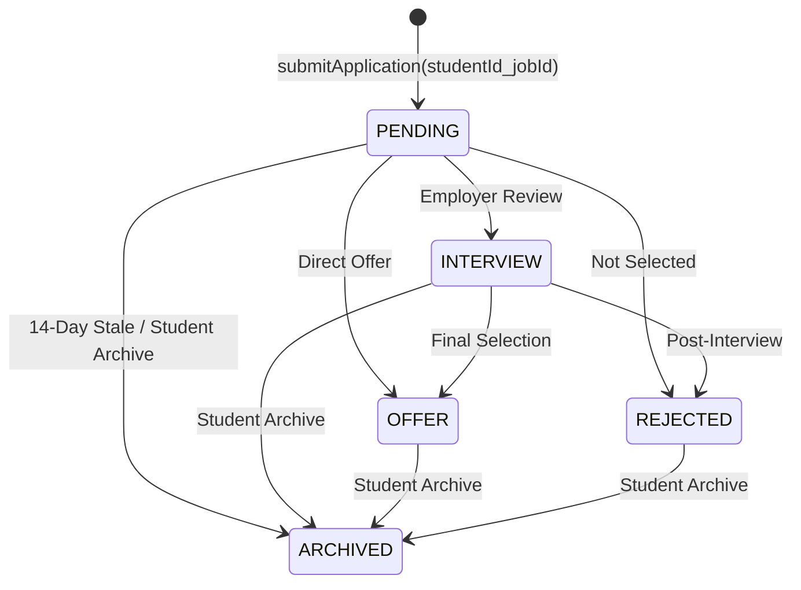

<div align="center">


<br />

<p align="center">
  <a href="#02--narrated-system-demonstration"><kbd>▶ &nbsp;WATCH 02:57 DEMO (en-ZA)</kbd></a>&nbsp;&nbsp;
  <a href="https://youtube.com/shorts/hio5pNRSheY?feature=share"><kbd>▶ &nbsp;WATCH ON YOUTUBE</kbd></a>&nbsp;&nbsp;
  <a href="#03--visual-feature-showcase"><kbd>03 &nbsp;FEATURE SHOWCASE</kbd></a>&nbsp;&nbsp;
  <a href="#04--architecture-security--state-engine"><kbd>04 &nbsp;SYSTEM ARCHITECTURE</kbd></a>&nbsp;&nbsp;
  <a href="#05--verification-setup--ci-pipeline"><kbd>05 &nbsp;SETUP &amp; 26 UNIT TESTS</kbd></a>&nbsp;&nbsp;
  <a href="#06--honest-limitations--listing-audit"><kbd>06 &nbsp;LIMITATIONS &amp; DATA AUDIT</kbd></a>&nbsp;&nbsp;
  <a href="Career_Connect_Verified_Screenshots.pdf"><kbd>📄 &nbsp;SCREENSHOTS DOSSIER (PDF)</kbd></a>
</p>

<sub>
  <b>Repository:</b> <a href="https://github.com/askdjajsndjas/Career-Connect"><code>github.com/askdjajsndjas/Career-Connect</code></a> &nbsp;&bull;&nbsp;
  <b>Android Source:</b> <a href="android/app/src/main/java/com/careerconnect"><code>android/app/src/main/java/com/careerconnect</code></a> &nbsp;&bull;&nbsp;
  <b>Firestore Rules:</b> <a href="firestore.rules"><code>firestore.rules</code></a> &nbsp;&bull;&nbsp;
  <b>Demo Master:</b> <a href="demo_career_connect_female_narrated.mp4"><code>demo_career_connect_female_narrated.mp4</code></a> &nbsp;&bull;&nbsp;
  <b>YouTube Demo (Unlisted):</b> <a href="https://youtube.com/shorts/hio5pNRSheY?feature=share"><code>youtube.com/shorts/hio5pNRSheY</code></a>
</sub>

</div>

<hr />

<h2 id="01--the-south-african-graduate-gap"><code>01 //</code> THE SOUTH AFRICAN GRADUATE GAP</h2>

<table>
  <tr>
    <td width="62%" valign="top">
      <h3>Designing for Johannesburg, Cape Town, Pretoria &amp; Durban — Not Silicon Valley</h3>
      <p>
        South African computing and engineering students entering the graduate market face a structural discovery problem: mainstream global job boards flood entry-level feeds with US-only remote listings, senior roles, or dead application pipelines that never communicate status updates.
      </p>
      <p>
        <b>Career Connect</b> is a native Android application engineered in Kotlin to bridge university study and early-career employment in South Africa. Instead of generic international listings, the platform pairs a curated catalog of South African graduate, intern, and junior roles across six academic disciplines with a filtered live remote feed from the <b>Remotive REST API</b> that strips out US/North-America-restricted postings and ranks opportunities explicitly open to South Africa first.
      </p>
      <p>
        Students can filter roles by their university pathway, submit and track applications backed by real-time <b>Cloud Firestore (<code>africa-south1</code>)</b> listeners, automatically archive stale applications after 14 days of inactivity, and author a structured CV whose personal fields are encrypted on-device using hardware-backed <b>AndroidKeyStore AES-256-GCM</b> cryptography.
      </p>
    </td>
    <td width="38%" valign="top">
      <h4><code>EDITORIAL INDEX //</code></h4>
      <ol>
        <li><a href="#01--the-south-african-graduate-gap"><b>The South African Graduate Gap</b></a><br /><sub>Problem statement &amp; regional focus</sub></li>
        <li><a href="#02--narrated-system-demonstration"><b>Narrated System Demonstration</b></a><br /><sub>02:57 HD walkthrough (<code>en-ZA</code>) &amp; animated preview</sub></li>
        <li><a href="#03--visual-feature-showcase"><b>Visual Feature Showcase</b></a><br /><sub>11 verified emulator captures across 5 chapters</sub></li>
        <li><a href="#04--architecture-security--state-engine"><b>Architecture, Security &amp; State Engine</b></a><br /><sub>Topology SVG, Firestore rules &amp; AES-256-GCM</sub></li>
        <li><a href="#05--verification-setup--ci-pipeline"><b>Verification, Setup &amp; CI Pipeline</b></a><br /><sub>26 passing unit tests &amp; reproducible build steps</sub></li>
        <li><a href="#06--honest-limitations--listing-audit"><b>Honest Limitations &amp; Listing Audit</b></a><br /><sub>Engineering boundaries &amp; 14-role source audit</sub></li>
      </ol>
      <hr />
      <sub>
        <b> Target Audience:</b> South African BSc IT, Computer Science &amp; Software Engineering students.<br />
        <b> Cloud Region:</b> Google Cloud <code>africa-south1</code> (Johannesburg).
      </sub>
    </td>
  </tr>
</table>

<hr />

<h2 id="02--narrated-system-demonstration"><code>02 //</code> NARRATED SYSTEM DEMONSTRATION</h2>

<table>
  <tr>
    <td width="62%" valign="middle" align="center">
      <a href="https://youtube.com/shorts/hio5pNRSheY?feature=share" title="Click to watch the narrated demo on YouTube (unlisted, 02:57)">
        
      </a>
      <br />
      <sub>
        <b>Click the cinema card above</b> to watch the demo on YouTube, or use the direct links below:<br />
        <a href="https://youtube.com/shorts/hio5pNRSheY?feature=share"><b>[Watch on YouTube (Unlisted)]</b></a> &nbsp;&bull;&nbsp;
        <a href="demo_career_connect_female_narrated.mp4"><b>[Open Repository Video Page]</b></a> &nbsp;&bull;&nbsp;
        <a href="https://github.com/askdjajsndjas/Career-Connect/raw/main/demo_career_connect_female_narrated.mp4"><b>[Direct Raw MP4 Download (7.49 MB)]</b></a> &nbsp;&bull;&nbsp;
        <a href="Career_Connect_Verified_Screenshots.pdf"><b>[Open Verified Screenshots PDF]</b></a>
      </sub>
    </td>
    <td width="38%" valign="middle" align="center">
      <a href="demo_career_connect_female_narrated.mp4">
        
      </a>
      <br />
      <sub>
        <b>Live 9-Screen Animated Preview (GIF)</b><br />
        Cycles through Welcome &rarr; Auth &rarr; SA Feed &rarr; Cyber Filter &rarr; Remotive API &rarr; Job Details &rarr; Tracker &rarr; CV Builder &rarr; Encrypted Profile.
      </sub>
    </td>
  </tr>
</table>

> [!IMPORTANT]
> **Watch in your browser (no download):** the full narrated demo is available as an unlisted YouTube video: [https://youtube.com/shorts/hio5pNRSheY?feature=share](https://youtube.com/shorts/hio5pNRSheY?feature=share). The original MP4 remains in the repository for offline download.
>
> **How Video Playback Works on GitHub:** GitHub sanitizes raw `<video>` HTML tags referencing repository-relative paths in `README.md`, and commits `demo_career_connect_female_narrated.mp4` (`7,852,454 bytes`, `1920x1080` H.264 video + `48 kHz` AAC stereo audio) directly in the repository root. Clicking the preview card or `[Direct Raw MP4 Download]` downloads/streams the full `02:57` narrated walkthrough directly from GitHub. *(Note for repository owner: ensure repository visibility in GitHub **Settings &rarr; Danger Zone** is set to **Public** so external graders can access the repository and raw MP4 stream without a 404 permissions wall.)*

<details>
<summary><b><code>TIMELINE //</code> Expand 7-Scene Narration Breakdown &amp; Timecodes (<code>00:00</code> – <code>02:57</code>)</b></summary>
<br />

| Scene | Timecode | Screen / Module | Demonstrated Capability &amp; Narration Focus (`en-ZA` Neural Voice) |
| :--- | :--- | :--- | :--- |
| **01** | `00:00 – 00:18` | `WelcomeActivity` &rarr; `LoginActivity` | Launches the entry portal and authenticates a returning student via **Firebase Authentication** (`FirebaseAuth.signInWithEmailAndPassword`). |
| **02** | `00:18 – 00:46` | `MainActivity` | Loads the South African graduate job feed (`14` localized roles across Johannesburg, Cape Town, Pretoria, Midrand, and Durban) and filters by **Cybersecurity** (`2` matching roles) and **Software Dev** (`4` matching roles). |
| **03** | `00:46 – 01:12` | `JobsActivity` (Remotive API) | Queries `https://remotive.com/api/remote-jobs` via **Retrofit 2**, discards US-restricted listings, and displays `🇿🇦 Open to South Africa` and `🌍 Global Remote` eligibility badges with Remotive attribution. |
| **04** | `01:12 – 01:30` | `JobDetailsActivity` | Inspects full role metadata, stipend/salary range in `ZAR`, location, and submits an application written to Cloud Firestore with composite ID `${studentId}_${jobId}`. |
| **05** | `01:30 – 01:58` | `ApplicationsActivity` &amp; `StatusNotifier` | Demonstrates real-time Firestore snapshot updates across `PENDING`, `INTERVIEW`, `OFFER`, `REJECTED`, and `ARCHIVED` states, plus local status notifications on channel `"application_status"`. |
| **06** | `01:58 – 02:40` | `ProfileActivity` &amp; `CVBuilderActivity` | Edits student profile and CV fields encrypted at rest via `AndroidKeyStore` (`AES/GCM/NoPadding`, 256-bit key) and renders the formatted in-app CV preview. |
| **07** | `02:40 – 02:57` | `ProfileActivity` Logout | Confirms session termination via `AlertDialog`, invokes `FirebaseAuth.getInstance().signOut()`, and clears back-stack navigation (`FLAG_ACTIVITY_NEW_TASK | FLAG_ACTIVITY_CLEAR_TASK`). |

</details>

<hr />

<h2 id="03--visual-feature-showcase"><code>03 //</code> VISUAL FEATURE SHOWCASE</h2>

### `CHAPTER 03.A //` Onboarding &amp; Firebase Session Authentication

<table>
  <tr>
    <td width="32%" align="center" valign="top">
      <br />
      <sub><b>Fig 01.</b> <code>WelcomeActivity.kt</code><br />Entry portal with session auto-routing</sub>
    </td>
    <td width="32%" align="center" valign="top">
      <br />
      <sub><b>Fig 02.</b> <code>LoginActivity.kt</code><br />Firebase Email/Password authentication</sub>
    </td>
    <td width="36%" valign="middle">
      <h4><code>AUTH PIPELINE</code></h4>
      <p>
        <b>Zero-Friction Returning Sessions:</b> On launch, <a href="android/app/src/main/java/com/careerconnect/WelcomeActivity.kt"><code>WelcomeActivity.kt</code></a> checks <code>FirebaseAuth.getInstance().currentUser</code>. Authenticated students bypass login and route straight into <code>MainActivity</code>.
      </p>
      <p>
        <b>Credential Validation &amp; Role Provisioning:</b> <a href="android/app/src/main/java/com/careerconnect/LoginActivity.kt"><code>LoginActivity.kt</code></a> and <a href="android/app/src/main/java/com/careerconnect/RegisterActivity.kt"><code>RegisterActivity.kt</code></a> validate email format and password constraints before invoking Firebase Auth. New student registrations write a `/users/{uid}` document constrained by <a href="firestore.rules"><code>firestore.rules</code></a> to <code>role == 'student'</code>, preventing client-side privilege escalation.
      </p>
    </td>
  </tr>
</table>

### `CHAPTER 03.B //` South African Career Pathways &amp; Eligibility-Filtered Remote Feeds

<table>
  <tr>
    <td width="33%" align="center" valign="top">
      <br />
      <sub><b>Fig 03.</b> <code>MainActivity.kt</code> — Default SA Feed<br /><code>All Opportunities (14)</code> in ZAR</sub>
    </td>
    <td width="33%" align="center" valign="top">
      <br />
      <sub><b>Fig 04.</b> <code>MainActivity.kt</code> — Pathway Chip<br /><code>Recommended &bull; Cybersecurity (2)</code></sub>
    </td>
    <td width="33%" align="center" valign="top">
      <br />
      <sub><b>Fig 05.</b> <code>JobsActivity.kt</code> — Remotive API<br /><code>🇿🇦 Open to South Africa</code> tiering</sub>
    </td>
  </tr>
</table>

<table>
  <tr>
    <td width="50%" valign="top">
      <h4><code>DYNAMIC ACADEMIC PATHWAY FILTERING</code></h4>
      <p>
        Rather than treating category buttons as static UI tabs, <a href="android/app/src/main/java/com/careerconnect/MainActivity.kt"><code>MainActivity.kt</code></a> binds six academic pathway chips (<b>Software Dev</b>, <b>Data &amp; AI</b>, <b>Cybersecurity</b>, <b>Cloud &amp; IT</b>, <b>FinTech &amp; Business</b>, and <b>Design &amp; Product</b>) to <a href="android/app/src/main/java/com/careerconnect/JobRepository.kt"><code>JobRepository.matchesCategory()</code></a>. Tapping a chip persists the student's preferred stream in <code>SharedPreferences</code>, dynamically recomputes the list adapter, and updates the live header count (e.g., <code>Recommended &bull; Cybersecurity (2)</code> in <b>Fig 04</b>).
      </p>
    </td>
    <td width="50%" valign="top">
      <h4><code>SA-ELIGIBLE REMOTIVE REST PIPELINE</code></h4>
      <p>
        In <a href="android/app/src/main/java/com/careerconnect/JobsActivity.kt"><code>JobsActivity.kt</code></a>, live remote jobs fetched from <code>https://remotive.com/api/remote-jobs</code> are passed through <code>JobRepository.classifyRemotiveEligibility()</code>. Listings restricted to the US, Canada, UK-only, or Latin America are discarded. Remaining roles are tagged and sorted with <b>Tier 1</b> (<code>🇿🇦 Open to South Africa</code> — explicitly naming South Africa, EMEA, or SAST/GMT+2) above <b>Tier 2</b> (<code>🌍 Global Remote</code>).
      </p>
    </td>
  </tr>
</table>

### `CHAPTER 03.C //` Role Inspection, Real-Time Application Tracker &amp; Status Alerts

<table>
  <tr>
    <td width="33%" align="center" valign="top">
      <br />
      <sub><b>Fig 06.</b> <code>JobDetailsActivity.kt</code><br />Role metadata, ZAR stipend &amp; Apply CTA</sub>
    </td>
    <td width="33%" align="center" valign="top">
      <br />
      <sub><b>Fig 07.</b> <code>ApplicationsActivity.kt</code><br />Saved, Applied &amp; Interview pipeline counters</sub>
    </td>
    <td width="33%" align="center" valign="top">
      <br />
      <sub><b>Fig 08.</b> Live Status Inspection Dialog<br />Real-time Firestore status &amp; local notification trigger</sub>
    </td>
  </tr>
</table>

<table>
  <tr>
    <td width="100%" valign="top">
      <p>
        <b>Idempotent Submissions &amp; Live Snapshot Tracking:</b> Submitting an application in <a href="android/app/src/main/java/com/careerconnect/JobDetailsActivity.kt"><code>JobDetailsActivity.kt</code></a> writes a document to <code>/applications/{studentId_jobId}</code> via <a href="android/app/src/main/java/com/careerconnect/ApplicationRepository.kt"><code>ApplicationRepository.submitApplication()</code></a>, preventing duplicate submissions for the same role. <a href="android/app/src/main/java/com/careerconnect/ApplicationsActivity.kt"><code>ApplicationsActivity.kt</code></a> attaches a real-time Firestore <code>SnapshotListener</code> to update summary counters (<b>Saved</b>, <b>Applied</b>, <b>Interview</b>) and color-coded status cards (`PENDING`, `INTERVIEW`, `OFFER`, `REJECTED`, `ARCHIVED`). Simultaneously, <a href="android/app/src/main/java/com/careerconnect/StatusNotifier.kt"><code>StatusNotifier.kt</code></a> monitors status transitions in the active session and posts local Android system notifications on channel <code>"application_status"</code> whenever an application's status changes.
      </p>
    </td>
  </tr>
</table>

### `CHAPTER 03.D //` Structured CV Builder, AES-256-GCM Profile &amp; Session Guard

<table>
  <tr>
    <td width="33%" align="center" valign="top">
      <br />
      <sub><b>Fig 09.</b> <code>CVBuilderActivity.kt</code><br />Structured editor &amp; rendered <code>CV PREVIEW</code> card</sub>
    </td>
    <td width="33%" align="center" valign="top">
      <br />
      <sub><b>Fig 10.</b> <code>ProfileActivity.kt</code><br />AES-256-GCM encrypted personal &amp; academic profile</sub>
    </td>
    <td width="33%" align="center" valign="top">
      <br />
      <sub><b>Fig 11.</b> Session Termination Guard<br />Confirmation modal &amp; back-stack wipe</sub>
    </td>
  </tr>
</table>

<table>
  <tr>
    <td width="50%" valign="top">
      <h4><code>IN-APP CV BUILDER &amp; LIVE PREVIEW</code></h4>
      <p>
        <a href="android/app/src/main/java/com/careerconnect/CVBuilderActivity.kt"><code>CVBuilderActivity.kt</code></a> (<b>Fig 09</b>) provides a structured six-section curriculum vitae editor covering Full Name, Contact Info, Education, Technical Skills, Experience/Projects, and Career Objective. Tapping <b>Save &amp; Generate CV Preview</b> encrypts every section via <code>ProfileActivity.writeSecurePref()</code> and immediately renders a formatted multi-section preview card inside the app.
      </p>
    </td>
    <td width="50%" valign="top">
      <h4><code>HARDWARE-BACKED PROFILE ENCRYPTION</code></h4>
      <p>
        <a href="android/app/src/main/java/com/careerconnect/ProfileActivity.kt"><code>ProfileActivity.kt</code></a> (<b>Fig 10</b>) generates a non-exportable 256-bit AES key inside the hardware-backed <code>AndroidKeyStore</code> (`career_connect_prefs_aes_key`) and encrypts each profile attribute using <code>AES/GCM/NoPadding</code> with a fresh 12-byte IV and 128-bit authentication tag (`enc:v1:&lt;ivB64&gt;:&lt;cipherB64&gt;`), supporting privacy-conscious local data handling on shared student devices.
      </p>
    </td>
  </tr>
</table>

<hr />

<h2 id="04--architecture-security--state-engine"><code>04 //</code> ARCHITECTURE, SECURITY &amp; STATE ENGINE</h2>

<div align="center">
  
</div>

<br />

<table>
  <tr>
    <td width="52%" valign="top">
      <h3>Application Lifecycle &amp; State Machine</h3>
      <p>
        Application status mutations are governed by <a href="android/app/src/main/java/com/careerconnect/StatusRules.kt"><code>StatusRules.kt</code></a> and mirrored in <a href="firestore.rules"><code>firestore.rules</code></a>:
      </p>
      <ul>
        <li><b>Composite Document Identity:</b> Every application document in `/applications/{appId}` uses `${studentId}_${jobId}` (`Application.compositeId`), ensuring idempotent creation (`!exists(...)` in Firestore rules).</li>
        <li><b>Forward Transitions:</b> <code>PENDING</code> applications can transition to <code>INTERVIEW</code>, <code>OFFER</code>, <code>REJECTED</code>, or <code>ARCHIVED</code>. Applications in <code>INTERVIEW</code> can transition to <code>OFFER</code>, <code>REJECTED</code>, or <code>ARCHIVED</code>.</li>
        <li><b>Terminal States:</b> <code>OFFER</code> and <code>REJECTED</code> are terminal for employers, while students may move their own application to <code>ARCHIVED</code> (`StatusRules.canStudentArchive`).</li>
        <li><b>14-Day Stale Auto-Archiving:</b> Whenever `StatusNotifier` receives a snapshot update, `ApplicationRepository.archiveStale()` checks `StatusRules.isStale(status, updatedAtMs, nowMs)` and automatically archives `PENDING` applications older than `14` days (`1,209,600,000 ms`).</li>
      </ul>
    </td>
    <td width="48%" valign="top">



    </td>
  </tr>
</table>

<details>
<summary><b><code>SECURITY RULES //</code> Inspect Declarative Cloud Firestore Access Control (<a href="firestore.rules"><code>firestore.rules</code></a>)</b></summary>
<br />

```javascript
rules_version = '2';
service cloud.firestore {
  match /databases/{database}/documents {
    match /users/{uid} {
      allow read: if request.auth != null && request.auth.uid == uid;
      allow create: if request.auth != null && request.auth.uid == uid
        && request.resource.data.role == 'student';
      allow update: if request.auth != null && request.auth.uid == uid
        && request.resource.data.role == resource.data.role;
      allow delete: if false;
    }
    match /applications/{appId} {
      allow read: if request.auth != null && (
        resource.data.studentId == request.auth.uid ||
        resource.data.employerId == request.auth.uid
      );
      allow create: if request.auth != null
        && request.resource.data.studentId == request.auth.uid
        && request.resource.data.status == 'PENDING'
        && appId == (request.auth.uid + '_' + request.resource.data.jobId)
        && !exists(/databases/$(database)/documents/applications/$(appId));
      allow delete: if false;
    }
  }
}
```

</details>

<hr />

<h2 id="05--verification-setup--ci-pipeline"><code>05 //</code> VERIFICATION, SETUP &amp; CI PIPELINE</h2>

<table>
  <tr>
    <td width="48%" valign="top">
      <h3>Verified Build &amp; Test Telemetry</h3>
      <p>
        Every domain rule, South African eligibility classifier, category filter, and stale-archiving calculation is verified by automated JUnit 4 unit tests and built automatically on every push via <a href=".github/workflows/ci.yml"><code>.github/workflows/ci.yml</code></a>:
      </p>
      <ul>
        <li><b>Gradle Tasks Verified:</b> <code>:app:testDebugUnitTest</code> &amp; <code>:app:assembleDebug</code> &mdash; <b><code>BUILD SUCCESSFUL</code></b></li>
        <li><b>Total Unit Tests Passing:</b> <b><code>26 / 26</code></b> (<code>0</code> failures, <code>0</code> errors)
          <ul>
            <li><a href="android/app/src/test/java/com/careerconnect/ExampleUnitTest.kt"><code>com.careerconnect.ExampleUnitTest</code></a>: <b>13 passed</b> (SA curation, 6 category filters, Remotive `SA_EXPLICIT` vs `GLOBAL_REMOTE` classification, US-only exclusion, ranking order)</li>
            <li><a href="android/app/src/test/java/com/careerconnect/StatusRulesTest.kt"><code>com.careerconnect.StatusRulesTest</code></a>: <b>12 passed</b> (valid/invalid transitions, terminal states, student archive rule, 14-day stale boundary)</li>
            <li><a href="android/app/src/test/java/Career/Connect/ExampleUnitTest.kt"><code>Career.Connect.ExampleUnitTest</code></a>: <b>1 passed</b> (baseline sanity check)</li>
          </ul>
        </li>
      </ul>
    </td>
    <td width="52%" valign="top">
      <h3>Local Build &amp; Run Instructions</h3>
      <p><b>Prerequisites:</b> Android Studio Ladybug+ (or Gradle CLI), <b>JDK 17 or JDK 21</b>, and Android SDK Platform <b>API 37</b> (`android-37.0-ext22`, `minSdk = 24`).</p>

```powershell
# 1. Clone the repository and move into the Android workspace
git clone https://github.com/askdjajsndjas/Career-Connect.git
cd Career-Connect/android

# 2. Run all 26 unit tests and assemble the debug APK
./gradlew testDebugUnitTest assembleDebug

# 3. Install the generated APK onto a connected device/emulator
adb install -r app/build/outputs/apk/debug/app-debug.apk
```

      <sub>
        <b>Firebase Configuration Note:</b> <a href="android/app/google-services.json"><code>android/app/google-services.json</code></a> is included in the repository for the `com.careerconnect` client package so graders can compile and test immediately without provisioning a separate Firebase project.
      </sub>
    </td>
  </tr>
</table>

<hr />

<h2 id="06--honest-limitations--listing-audit"><code>06 //</code> HONEST LIMITATIONS &amp; LISTING AUDIT</h2>

To ensure rigorous academic and engineering transparency, the following architectural boundaries apply to the current version of **Career Connect**:

1. **Simulated Application Portal URLs on the 14 Local Seed Listings (`example.com`):**
   While the **Remotive API** tab (`JobsActivity`) fetches live remote job postings with real external application URLs on `remotive.com`, the **14 South African listings** in `JobRepository.kt` are local seed records whose `applyUrl` fields point to `https://example.com/...` test endpoints and whose `employerId` defaults to `"demo"` in `JobDetailsActivity.kt`.
2. **Student-Only Mobile Client (No Employer Portal UI):**
   Although `firestore.rules` supports employer status updates when `resource.data.employerId == request.auth.uid`, this mobile app only implements the **student-facing experience**. Furthermore, because applications created from the 14 local seed roles assign `employerId = "demo"`, updating an application's status to `INTERVIEW`, `OFFER`, or `REJECTED` during testing requires updating the document via the Firebase Console (or authenticating as UID `"demo"`).
3. **Foreground Snapshot Notifications (Not FCM Background Push):**
   `StatusNotifier.kt` uses a live Firestore `SnapshotListener` attached during the active app session to trigger local system notifications on channel `"application_status"` (requiring `POST_NOTIFICATIONS` runtime permission on Android 13+). It does not use Firebase Cloud Messaging (FCM) background wake-up workers when the process is killed.
4. **Device-Local CV &amp; Encrypted Profile Storage (Not Certified POPIA Compliance):**
   Profile and CV fields encrypted with `AndroidKeyStore` (`AES/GCM/NoPadding`) are stored locally in device `SharedPreferences` (`career_connect_profile`) and are not synchronized across multiple devices or exported as PDF files. While hardware-backed encryption supports privacy-aligned local storage practices, the application does **not** claim formal legal certification under the Protection of Personal Information Act (POPIA).
5. **Public Remotive API Rate &amp; Delay Policy:**
   The public `https://remotive.com/api/remote-jobs` endpoint is delayed by 24 hours per Remotive's public API terms and requires network connectivity (returning an empty state if offline).

<details>
<summary><b><code>DATA AUDIT //</code> Expand Full Audit of All 14 Local South African Listings in <a href="android/app/src/main/java/com/careerconnect/JobRepository.kt"><code>JobRepository.kt</code></a></b></summary>
<br />

All 14 local listings are defined in `JobRepository.curatedSouthAfricanJobs` (`android/app/src/main/java/com/careerconnect/JobRepository.kt`). Nine reference real South African enterprises (using simulated `https://example.com/...` application URLs for safe prototype testing) and five represent synthetic South African graduate programmes:

| ID | Role Title | Listed Organization | Location | Pathway | Organization &amp; Link Verification Status |
| :--- | :--- | :--- | :--- | :--- | :--- |
| `sa-1` | Graduate Software Engineer | **Standard Bank Group** | Johannesburg (Hybrid) | Software Dev | Real SA Tier-1 bank; `https://example.com/jobs/sa-1` is a simulated prototype URL. |
| `sa-2` | Junior Android Developer (Kotlin) | **Takealot Group** | Cape Town (Hybrid) | Software Dev | Real SA e-commerce leader; `https://example.com/jobs/sa-2` is a simulated prototype URL. |
| `sa-3` | Software Engineering Intern | **Entelect** | Johannesburg / Pretoria | Software Dev | Real SA software engineering firm; `https://example.com/jobs/sa-3` is a simulated prototype URL. |
| `sa-4` | Junior Data Scientist / ML Graduate | **Discovery Limited** | Sandton, JHB (Hybrid) | Data &amp; AI | Real SA financial/insurtech group; `https://example.com/jobs/sa-4` is a simulated prototype URL. |
| `sa-5` | Data Analytics Intern | **ShopriteX** | Brackenfell, Cape Town | Data &amp; AI | Real SA retail tech innovation division; `https://example.com/jobs/sa-5` is a simulated prototype URL. |
| `sa-6` | Cybersecurity SOC Analyst Graduate | **Dimension Data (NTT DATA)** | Johannesburg (On-site) | Cybersecurity | Real SA systems integrator; `https://example.com/jobs/sa-6` is a simulated prototype URL. |
| `sa-7` | Junior Cloud &amp; DevOps Engineer | **Vodacom South Africa** | Midrand (Hybrid) | Cloud &amp; IT | Real SA telecoms operator; `https://example.com/jobs/sa-7` is a simulated prototype URL. |
| `sa-8` | FinTech Business Analyst Graduate | **Capitec Bank** | Stellenbosch / Cape Town | FinTech &amp; Business | Real SA retail bank; `https://example.com/jobs/sa-8` is a simulated prototype URL. |
| `sa-9` | Product Design (UI/UX) Intern | **Yoco** | Cape Town (Hybrid) | Design &amp; Product | Real SA payments/fintech company; `https://example.com/jobs/sa-9` is a simulated prototype URL. |
| `sa-10` | IT Support &amp; Systems Graduate Trainee | **Mzansi Cloud Solutions** | Durban (On-site) | Cloud &amp; IT | Synthetic prototype company &amp; `https://example.com/jobs/sa-10` simulated URL. |
| `sa-11` | Junior Full-Stack Developer (Remote SA) | **Cape Tech Collective** | Remote (South Africa) | Software Dev | Synthetic prototype company &amp; `https://example.com/jobs/sa-11` simulated URL. |
| `sa-12` | Junior Information Security Consultant | **Ubuntu Cyber Defence** | Pretoria (Hybrid) | Cybersecurity | Synthetic prototype company &amp; `https://example.com/jobs/sa-12` simulated URL. |
| `sa-13` | Quantitative &amp; FinTech Graduate Associate | **Jozi FinTech Labs** | Rosebank, Johannesburg | FinTech &amp; Business | Synthetic prototype company &amp; `https://example.com/jobs/sa-13` simulated URL. |
| `sa-14` | Digital Product &amp; UX Research Graduate | **Protea Digital Studio** | Remote (South Africa) | Design &amp; Product | Synthetic prototype company &amp; `https://example.com/jobs/sa-14` simulated URL. |

</details>

<hr />

<div align="center">
  <sub>
    <b>CAREER CONNECT // FINAL-YEAR SOFTWARE ENGINEERING SUBMISSION (2026)</b><br />
    Engineered in Kotlin for South African Students &amp; Graduates &bull; <a href="#01--the-south-african-graduate-gap">Back to Top &uarr;</a>
  </sub>
</div>
