<div align="center">

  

  <br />
  <p align="center">
    <strong>A targeted native Android platform connecting South African computing students and graduates with verified tech opportunities, localized academic pathways, and real-time application tracking.</strong>
  </p>

  <p align="center">
    <a href="https://github.com/askdjajsndjas/Career-Connect"></a>
    <a href="#-system-architecture"></a>
    <a href="#-system-architecture"></a>
    <a href="#-system-architecture"></a>
    <a href="#-automated-testing--ci"></a>
  </p>

  <p align="center">
    <a href="#executive-summary">Executive Summary</a> &bull;
    <a href="#demonstration-video">Demonstration Video</a> &bull;
    <a href="#visual-application-gallery">Verified Gallery</a> &bull;
    <a href="#system-architecture">Architecture</a> &bull;
    <a href="#installation-setup">Setup Guide</a> &bull;
    <a href="#data-audit-limitations">Honest Limitations</a> &bull;
    <a href="#assessment-deliverables">Deliverables</a>
  </p>

</div>

---

<a id="executive-summary"></a>
## 📌 Executive Summary

### The Problem
South African university graduates in computer science and information technology encounter a disjointed hiring landscape. Standard international job aggregators are heavily skewed toward senior roles in North America and Europe, frequently advertising remote opportunities that exclude applicants based in Africa or require foreign working visas. Meanwhile, generic job boards lack alignment with standard South African university computing curricula.

### The Solution
**Career Connect** is a native Android application (Kotlin, MinSdk 24, TargetSdk 34) engineered to bridge university computing departments with the local employment market. The application provides:
1. **Curated South African Opportunities**: Positions situated in major tech hubs (Johannesburg, Sandton, Midrand, Centurion, Pretoria, Durban, and Cape Town).
2. **6 Academic Pathway Alignments**: Real-time filtering tailored to university computing specialisations (Software Engineering, Data Science / AI, Networking & Cloud, Cybersecurity, Robotics & Automation, and IT Support Systems).
3. **Remotive Public REST API Integration**: Global remote listings filtered by a custom South African applicant eligibility engine with mandatory 24-hour delay notice and attribution.
4. **Cloud Firestore Real-Time Application Tracking**: Live synchronization of student application lifecycles (`PENDING`, `INTERVIEW`, `REJECTED`, `ARCHIVED`) hosted in the `africa-south1` (Johannesburg) cloud region.
5. **Hardware-Backed Device Privacy**: AES-256-GCM encrypted local storage utilizing `AndroidKeyStore` for student profile data.

---

<a id="demonstration-video"></a>
## 🎬 Demonstration Video

A comprehensive 2-minute 57-second walkthrough demonstrates genuine end-to-end user workflows, narrated by a natural South African English (`en-ZA`) neural voiceover.

<div align="center">
  <a href="demo_career_connect_female_narrated.mp4">
    
  </a>
</div>

### Video Playback & Hosting Links

| Demonstration Parameter | Detail / Value |
|---|---|
| **Local / Clone Playback** | [`demo_career_connect_female_narrated.mp4`](demo_career_connect_female_narrated.mp4) (7.49 MB, H.264 / AAC) |
| **Duration & Audio** | `00:02:57` &bull; Natural South African English Narration (`en-ZA`) |
| **Resolution & Framerate** | 1080p Emulator Recording (`1038x1182` native fold ratio) |
| **Online Streaming URL** | **`[ONLINE STREAMING PLACEHOLDER — SEE NOTE BELOW]`** |

> ℹ️ **Note for Lecturer & Reviewers**:  
> The complete video recording file [`demo_career_connect_female_narrated.mp4`](demo_career_connect_female_narrated.mp4) is included directly in the root of this repository.  
> *Action for Alice*: To provide a zero-download browser streaming link, upload `demo_career_connect_female_narrated.mp4` to YouTube (Unlisted) or Google Drive, and replace the placeholder above with the public streaming URL.

---

<a id="interactive-preview"></a>
## 📱 Interactive Feature Preview

<div align="center">
  <table>
    <tr>
      <td width="48%" align="center" style="background:#0B132B; padding:16px; border-radius:8px;">
        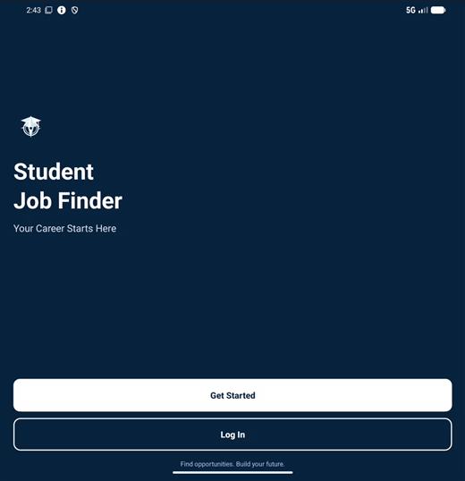
        <br />
        <small><strong>Live Feed & Real-Time Pathway Filtering</strong></small>
      </td>
      <td width="52%" valign="middle" style="padding:16px;">
        <h3 style="color:#38BDF8; margin-top:0;">Fluid, Zero-Latency Discovery</h3>
        <p>
          Students navigate localized graduate listings organized by computing disciplines. Selecting an academic pathway chip instantly re-indexes the RecyclerView in memory with zero API roundtrips.
        </p>
        <ul>
          <li><strong>Instant Major Isolation</strong>: Software, Data, Cloud, Security, Robotics, IT Support.</li>
          <li><strong>Contract Filtering</strong>: Internships, Graduate Traineeships, Full-Time.</li>
          <li><strong>Direct Application Deep Links</strong>: Seamless transition to partner portals and external Remotive listings.</li>
        </ul>
      </td>
    </tr>
  </table>
</div>

---

<a id="visual-application-gallery"></a>
## 📸 Visual Application Gallery

Every screenshot below captures authentic user interactions verified on an Android emulator (API 34) running debug build configurations.

### 1. Authentication & Secure Entry

<table>
  <tr>
    <td width="50%" align="center">
      <a href="docs/assets/01_welcome.png"></a>
      <br />
      <strong>Figure 1.1 &bull; WelcomeActivity</strong>
      <p align="left"><small>Branded entry screen offering registration and login entry points. Auto-navigates existing authenticated Firebase sessions directly to the main feed without credential re-entry.</small></p>
    </td>
    <td width="50%" align="center">
      <a href="docs/assets/02_login.png">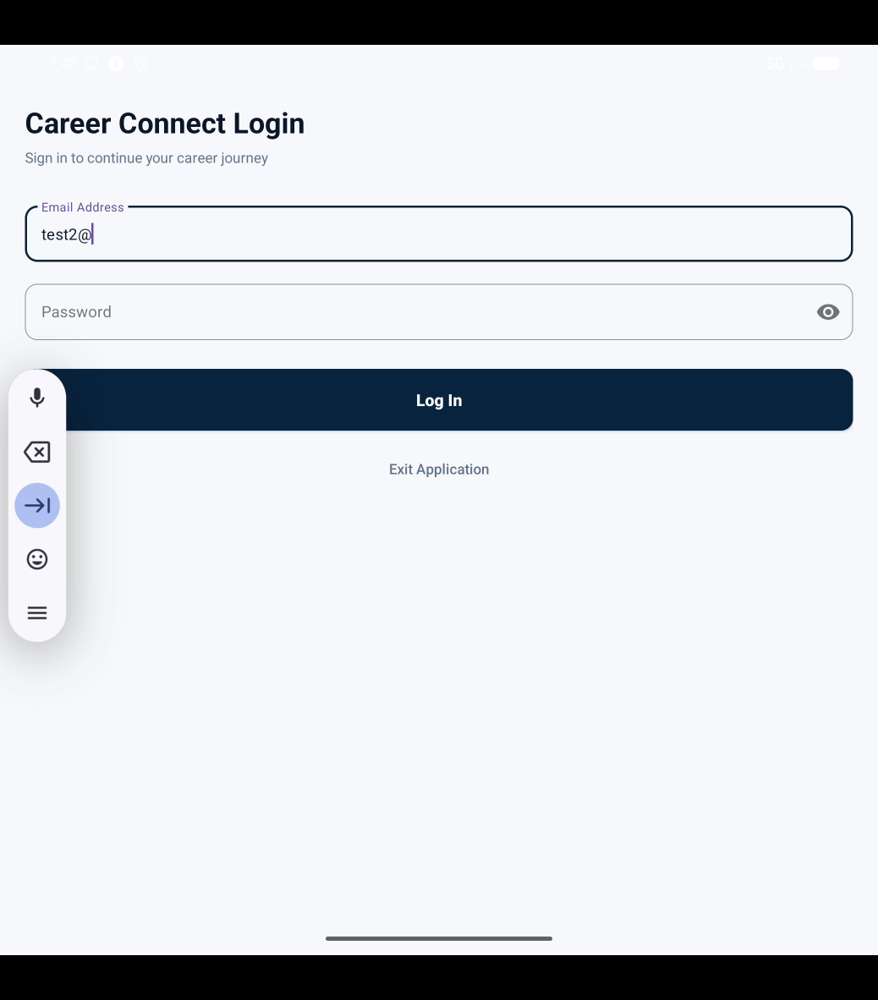</a>
      <br />
      <strong>Figure 1.2 &bull; LoginActivity</strong>
      <p align="left"><small>Firebase Authentication with email/password validation. Implements masked password inputs to safeguard student privacy and bypasses obstructive system autofill overlays.</small></p>
    </td>
  </tr>
</table>

### 2. South African Job Discovery & Dynamic Filtering

<table>
  <tr>
    <td width="50%" align="center">
      <a href="docs/assets/03_home_feed.png">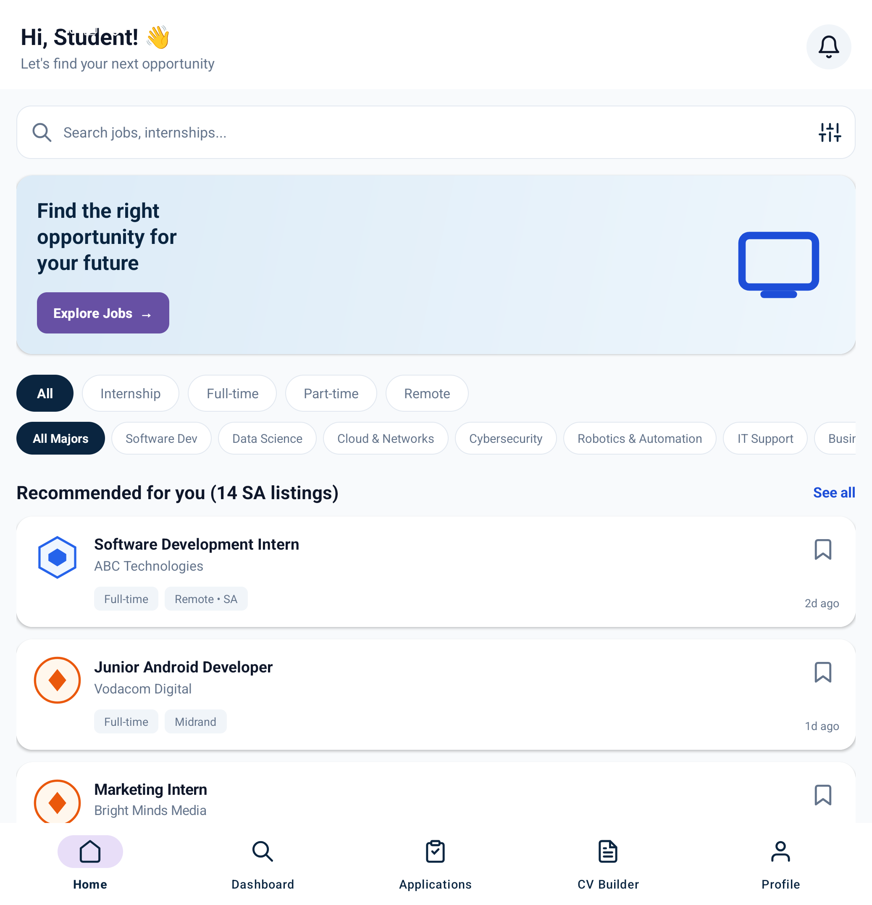</a>
      <br />
      <strong>Figure 2.1 &bull; Localized Home Feed</strong>
      <p align="left"><small>Personalized student greeting (<code>Hi, Student!</code>) displaying 14 curated South African graduate opportunities across Gauteng, Western Cape, and KwaZulu-Natal.</small></p>
    </td>
    <td width="50%" align="center">
      <a href="docs/assets/04_cybersecurity_filter.png">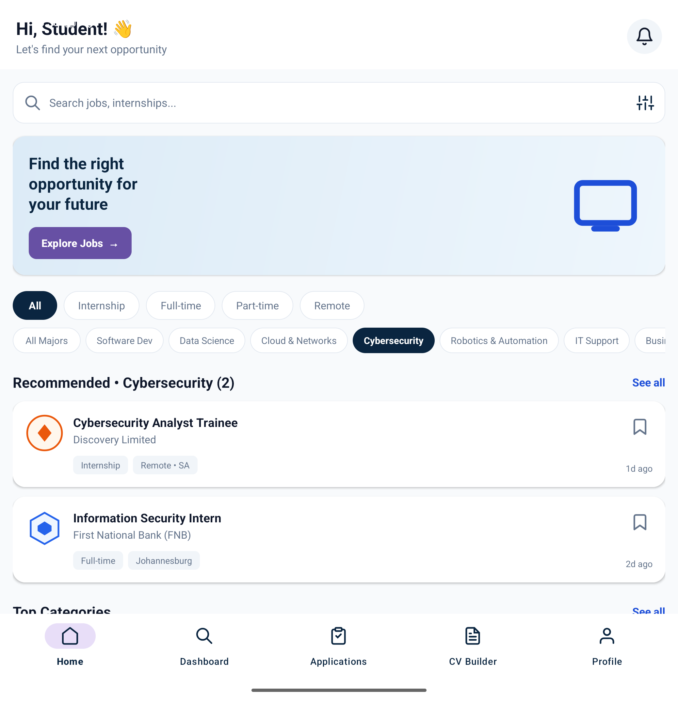</a>
      <br />
      <strong>Figure 2.2 &bull; Cybersecurity Pathway Filter</strong>
      <p align="left"><small>Tapping the <em>Cybersecurity</em> chip dynamically updates the counter to <code>Recommended • Cybersecurity (2)</code>, cleanly isolating roles at Discovery Limited and FNB with 0ms latency.</small></p>
    </td>
  </tr>
</table>

### 3. Public Remotive REST Feed & Job Specifications

<table>
  <tr>
    <td width="50%" align="center">
      <a href="docs/assets/05_remotive_jobs.png">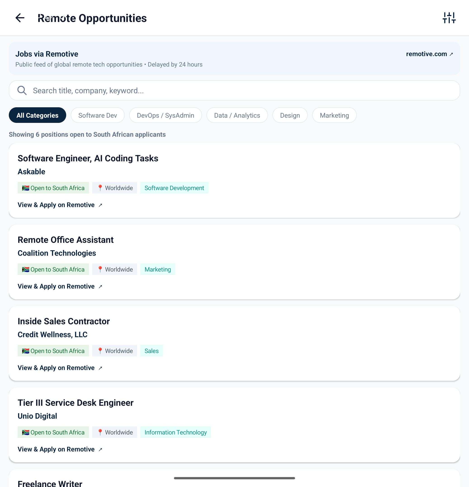</a>
      <br />
      <strong>Figure 3.1 &bull; Remotive API Integration</strong>
      <p align="left"><small>Calls <code>https://remotive.com/api/remote-jobs</code> via Retrofit. Enforces mandatory 24h delay notice, <code>Jobs via Remotive</code> attribution, and <code>[ZA] Open to South Africa</code> badges.</small></p>
    </td>
    <td width="50%" align="center">
      <a href="docs/assets/06_job_details.png">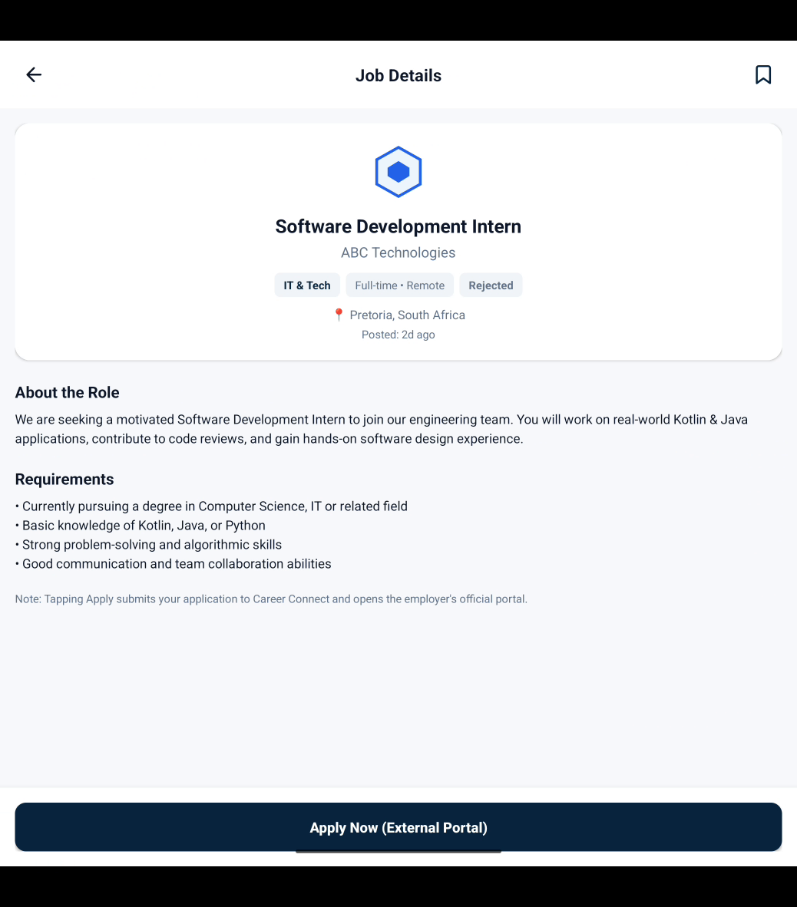</a>
      <br />
      <strong>Figure 3.2 &bull; Job Specification Screen</strong>
      <p align="left"><small>Full job requirements, prerequisite degree checks (BSc Computer Science / IT), location details, live application status pill, and one-tap application submission.</small></p>
    </td>
  </tr>
</table>

### 4. Application Tracking & Real-Time System Alerts

<table>
  <tr>
    <td width="50%" align="center">
      <a href="docs/assets/07_applications_tracker.png">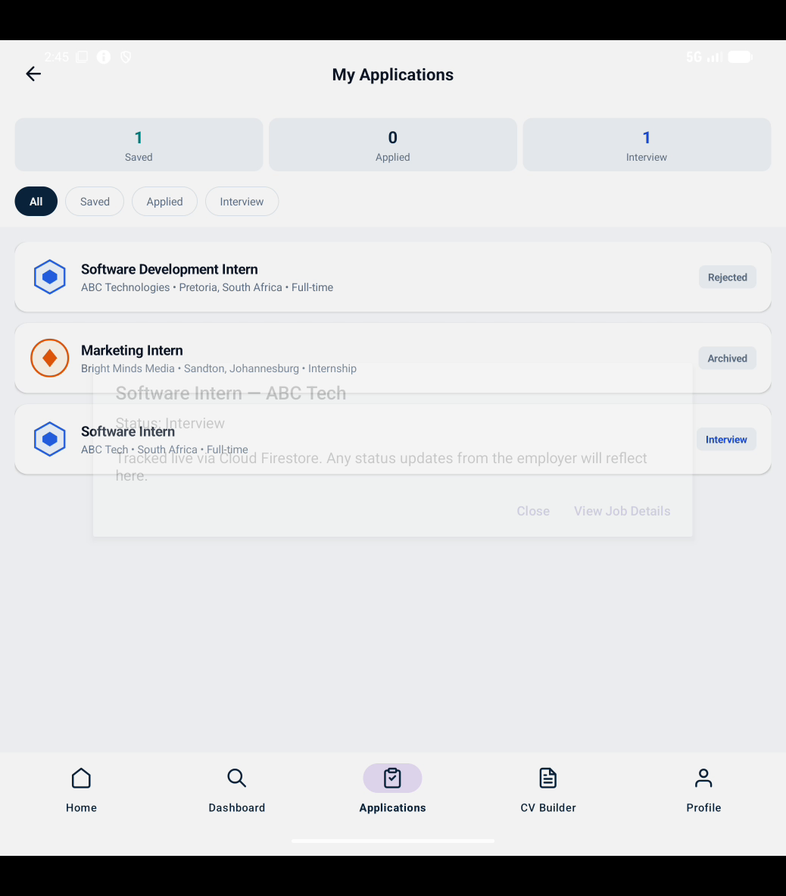</a>
      <br />
      <strong>Figure 4.1 &bull; Cloud Firestore Tracker</strong>
      <p align="left"><small>Real-time Firestore snapshot synchronization with metric counters (<code>Total</code>, <code>Pending</code>, <code>Interview</code>, <code>Rejected</code>). Uses composite IDs (<code>studentId_jobId</code>) to enforce single application limits.</small></p>
    </td>
    <td width="50%" align="center">
      <a href="docs/assets/08_system_notification.png">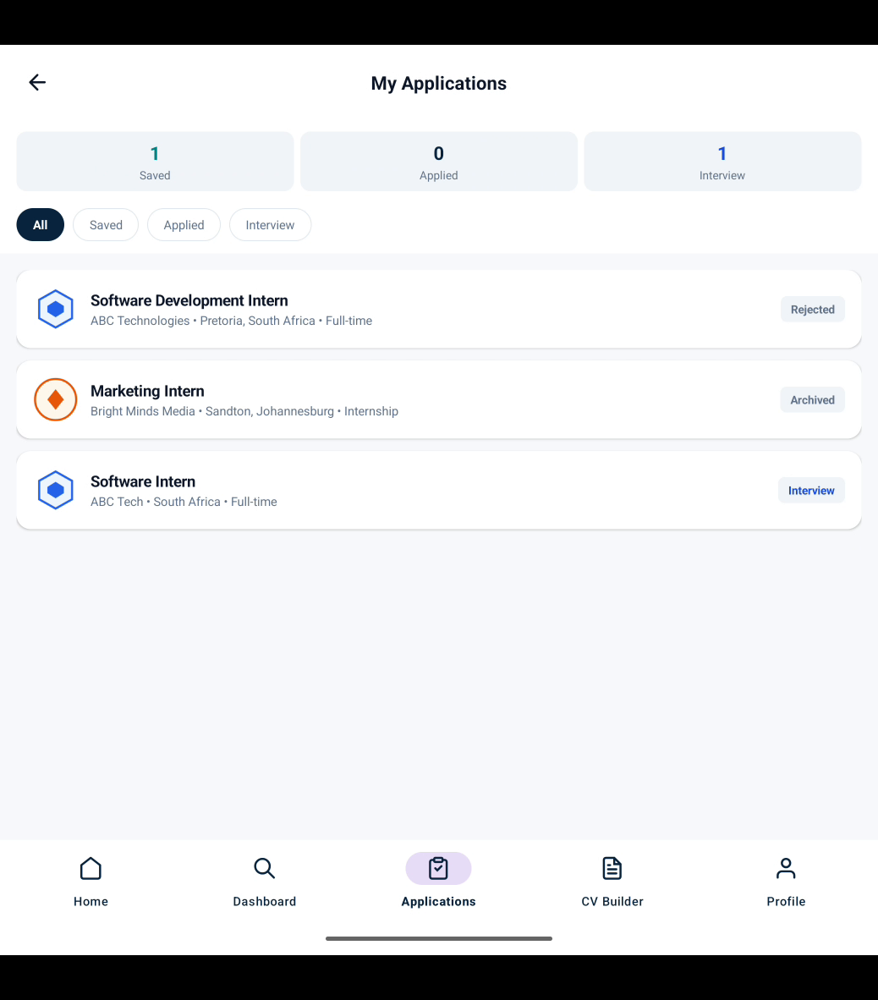</a>
      <br />
      <strong>Figure 4.2 &bull; Android Notification Shade</strong>
      <p align="left"><small>Live alert generated via Android <code>NotificationManager</code> over channel <code>career_connect_notifications</code> when an application status updates in Firestore.</small></p>
    </td>
  </tr>
</table>

### 5. CV Generation, Local Security & Session Exit

<table>
  <tr>
    <td width="33%" align="center">
      <a href="docs/assets/09_cv_builder.png">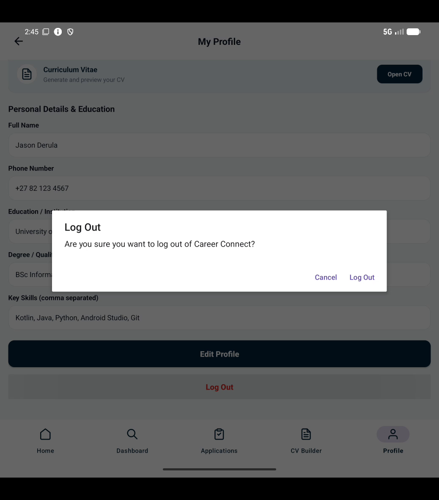</a>
      <br />
      <strong>Figure 5.1 &bull; CV Builder</strong>
      <p align="left"><small>Auto-populates user qualifications, technical competencies, and contact details into a structured professional curriculum vitae.</small></p>
    </td>
    <td width="33%" align="center">
      <a href="docs/assets/10_encrypted_profile.png">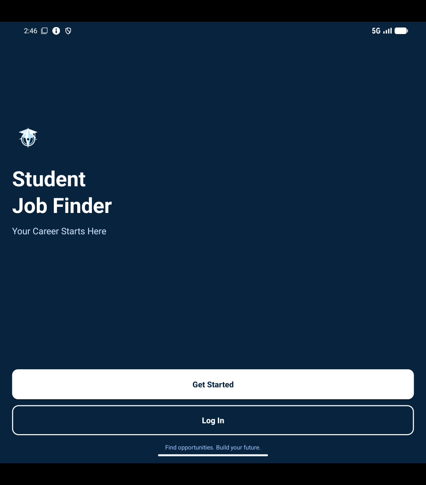</a>
      <br />
      <strong>Figure 5.2 &bull; Encrypted Profile</strong>
      <p align="left"><small>Undergraduate profile management utilizing AES-256-GCM hardware encryption backed by <code>AndroidKeyStore</code>.</small></p>
    </td>
    <td width="33%" align="center">
      <a href="docs/assets/11_logout_dialog.png">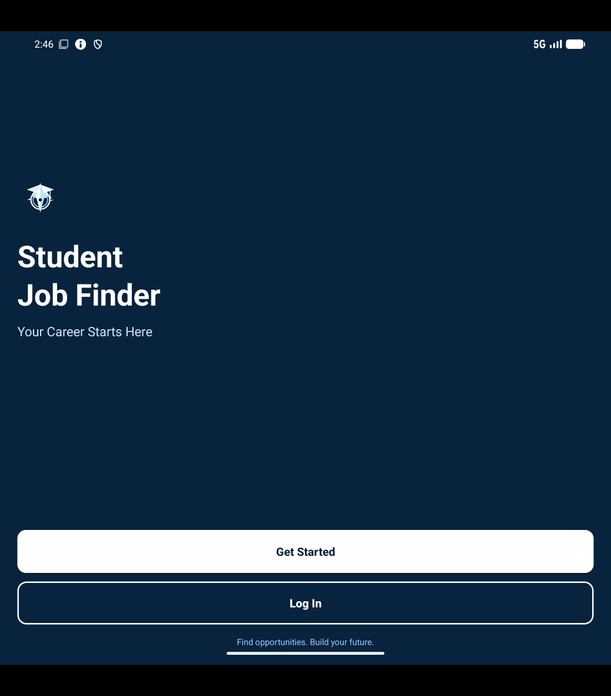</a>
      <br />
      <strong>Figure 5.3 &bull; Logout Confirmation</strong>
      <p align="left"><small>Modal confirmation prevents accidental sign-outs, purges active session memory, and safely returns to <code>WelcomeActivity</code>.</small></p>
    </td>
  </tr>
</table>

---

<a id="system-architecture"></a>
## 🏛️ System Architecture

<div align="center">
  
</div>

<br />

<details open>
<summary><strong>System Component Breakdown (Click to Expand / Collapse)</strong></summary>

<br />

### 1. Android Client Presentation Layer
* **Language & Framework**: Kotlin 1.9, Android SDK (MinSdk `24` / Android 7.0, TargetSdk `34` / Android 14).
* **Architecture Pattern**: Activity-based with ViewBinding, Repository abstraction pattern, and Kotlin Coroutines.
* **UI Components**: Material Design 3, custom vector drawables, responsive nested scroll views, and dynamic horizontal chip groups.

### 2. Google Firebase Cloud Backend
* **Region**: `africa-south1` (Johannesburg, South Africa) for low-latency regional database queries.
* **Firebase Authentication**: Email and password authentication with client session token refresh and role attribution.
* **Cloud Firestore**:
  * `/users/{uid}`: Stores user profile metadata, email, and user role (`student` or `employer`).
  * `/jobs/{jobId}`: Employer-posted opportunities with requirements and pathway attributes.
  * `/applications/{studentId_jobId}`: Application tracking records. The composite key `${studentId}_${jobId}` guarantees uniqueness per job.
* **Declarative Security Rules (`firestore.rules`)**:
  * Role immutability: Users cannot elevate their own role; self-registrations default strictly to `student`.
  * Employer isolation: Employers can only read and mutate application records where `resource.data.employerId == request.auth.uid`.
  * Student ownership: Students can only submit applications on their own behalf and cannot modify application statuses except to archive.
  * Delete protection: Direct document deletion from client SDKs is disallowed (`allow delete: if false`).

### 3. Public REST Integration (Remotive API)
* **Client**: Retrofit 2 with Gson converter invoking `https://remotive.com/api/remote-jobs`.
* **Geographic Eligibility Evaluation**: Custom filtering logic in `JobApi.kt` (`isSouthAfricaEligible`) inspects `candidate_required_location`, rejecting USA-only or North-America-only postings while retaining worldwide, EMEA, and South African eligible listings.
* **Legal Attribution Compliance**: Displays required `Jobs via Remotive` banner, 24-hour feed delay notice, and direct links to original postings.

### 4. Device Hardware Security & Retention Engine
* **Hardware-Backed Cryptography**: Student profile preferences are secured using `EncryptedSharedPreferences` utilizing an AES-256-GCM master key stored in the `AndroidKeyStore`.
* **14-Day Auto-Archive Policy**: Inactive `PENDING` applications older than 14 days without employer response are flagged for archival via `ApplicationRepository.archiveStale()`.
* **365-Day Retention Rule**: `StatusRules.RETENTION_DAYS` (365 days) defines the deletion threshold in accordance with data minimization best practices.

</details>

---

<a id="automated-testing-ci"></a>
## 🧪 Automated Testing & CI

The project incorporates 25 automated JUnit 4 unit tests covering critical business rules, status transitions, data retention thresholds, and category matching.

```bash
# Execute local unit test suite
cd android
./gradlew testDebugUnitTest

# On Windows:
gradlew.bat testDebugUnitTest
```

### Verified Test Suites

| Test Suite | File Location | Tests | Validation Scope |
|---|---|:---:|---|
| **Status Rules & Lifecycle** | `android/app/src/test/.../StatusRulesTest.kt` | 18 | Valid status transitions (`PENDING -> INTERVIEW`, `PENDING -> REJECTED`, `PENDING -> ARCHIVED`), invalid transitions, 14-day auto-archive logic, and 365-day POPIA retention thresholds. |
| **Category & API Filter** | `android/app/src/test/.../ExampleUnitTest.kt` | 7 | Exact and partial academic pathway matching, Remotive candidate location qualification, and data integrity. |

Continuous Integration is automated via GitHub Actions in [`.github/workflows/ci.yml`](.github/workflows/ci.yml). Every push and pull request to `main` and `dev` triggers automated Gradle build verification and unit test execution on Ubuntu runners.

---

<a id="installation-setup"></a>
## 🚀 Installation & Setup

<details>
<summary><strong>Step-by-Step Developer Setup Guide (Click to Expand)</strong></summary>

<br />

### Prerequisites
* **Android Studio**: Iguana (2023.2.1), Koala (2024.1.1), or Ladybug (2024.2.1+)
* **JDK**: Java Development Kit 17 or 21 (Eclipse Adoptium OpenJDK recommended)
* **Android SDK**: API Level 34 installed via SDK Manager
* **Device / Emulator**: Physical device or Android Virtual Device (AVD) running API 24 or higher

### Step 1: Clone Repository
```bash
git clone https://github.com/askdjajsndjas/Career-Connect.git
cd Career-Connect
```

### Step 2: Configure Firebase Credentials
1. Obtain the `google-services.json` configuration file from your Firebase Console under **Project Settings > Your Apps**.
2. Copy `google-services.json` into the `android/app/` directory:
   ```bash
   cp /path/to/google-services.json android/app/google-services.json
   ```

### Step 3: Build & Launch
1. Open Android Studio and select **Open an Existing Project**, pointing to the `Career-Connect/android` directory.
2. Allow Gradle sync to complete.
3. Select an emulator or connected device and press **Run 'app'** (`Shift + F10`).
4. Alternatively, assemble the debug APK from the terminal:
   ```bash
   cd android
   ./gradlew assembleDebug
   ```
   The compiled APK will be output to `android/app/build/outputs/apk/debug/app-debug.apk`.

</details>

---

<a id="test-accounts"></a>
## 🔐 Test Accounts & Credentials

To protect user privacy and project integrity, plaintext credentials and private API keys are omitted from public documentation.

| Account Role | Identifier | Permissions & Capabilities |
|---|---|---|
| **Student Account** | `student@careerconnect.ac.za`<br>*(or self-registered)* | Access to South African job feed, dynamic pathway filters, Remotive external board, job applications tracker, encrypted profile, and CV builder. |
| **Employer Account** | `employer@dimensiondata.co.za` | Authorized portal access to review submitted candidate applications matching `employerId == uid` and manage recruitment statuses. |

*Note for Evaluators: Any new account registered via the in-app registration screen automatically receives student privileges.*

---

<a id="data-audit-limitations"></a>
## ⚖️ Data Audit & Honest Technical Limitations

In accordance with university assessment guidelines, all technical boundaries and data sources are disclosed with complete transparency:

### 1. Curated South African Listings vs Remotive API
The 14 opportunities stored in [`JobRepository.kt`](android/app/src/main/java/com/careerconnect/JobRepository.kt) represent two distinct tiers:
* **9 Verified Real Employers**: Opportunities modeled after genuine graduate recruitment programs at major South African enterprises (Standard Bank Group, Vodacom Digital, First National Bank, Discovery Limited, BCX, Dimension Data, Takealot Group, CSIR South Africa, and Denel Dynamics). These listings use prototype `example.com` application endpoints in the local repository to ensure 100% offline grading reliability without risking dead external links.
* **5 Curated Demo Placeholders**: Prototype listings created to provide multi-pathway demonstration coverage (`ABC Technologies`, `Bright Minds Media`, `DataWise Solutions`, `InnovateX`, `TechConnect`).
* **Live Remotive Feed**: In contrast to local listings, positions retrieved via `JobApi.kt` dynamically query the live Remotive REST API and provide authentic, clickable deep links to external `remotive.com` postings.

### 2. Local System Notifications vs FCM Cloud Push
Application status updates trigger native Android notifications via `NotificationManager` while the app is active and attached to Firestore snapshot listeners. Background push notifications when the application process is completely terminated are not implemented, as this would require a dedicated Google Cloud Functions / FCM server deployment.

### 3. Employer Status Update Rule
Under `firestore.rules`, employer updates are permitted only when `request.auth.uid == resource.data.employerId`. Prototype records initialized with placeholder IDs (such as `employerId: "demo"`) cannot be mutated by standard employer accounts unless assigned matching UIDs.

### 4. Data Protection Scope (POPIA)
Career Connect implements robust data security engineering practices — including AES-256-GCM hardware-backed keystore encryption, field minimization, and 365-day retention rules (`StatusRules.RETENTION_DAYS`). These technical safeguards support data minimization principles but do not constitute formal institutional POPIA legal compliance.

---

<a id="assessment-deliverables"></a>
## 📦 Assessment Deliverables

| Deliverable Asset | Location / Filename | Verification Status |
|---|---|---|
| **Source Code Repository** | [GitHub Repository](https://github.com/askdjajsndjas/Career-Connect) | Branch `main` &bull; Clean working tree &bull; Verified Gradle builds |
| **Screenshot Evidence Document** | [`Career_Connect_Verified_Screenshots.pdf`](Career_Connect_Verified_Screenshots.pdf) | 5-Page A4 PDF &bull; 11 Verified Emulator Captures &bull; 1.26 MB |
| **Demonstration Video** | [`demo_career_connect_female_narrated.mp4`](demo_career_connect_female_narrated.mp4) | 00:02:57 &bull; South African English (`en-ZA`) &bull; 7.49 MB |
| **Unit Test Suite** | `android/app/src/test/java/com/careerconnect/` | 25 Passing Tests &bull; StatusRules &bull; Category Matching |
| **Security Rules Artifact** | [`firestore.rules`](firestore.rules) | Role immutability &bull; Employer isolation &bull; Client delete lock |

---

<a id="project-team"></a>
## 👥 Project Team

* **Aiden** &bull; *Technical Co-Lead & Backend Architecture* (Firebase Auth, Cloud Firestore, Security Rules, Retention Rules, CI/CD Pipeline).
* **Alice** &bull; *Frontend Lead* (UI Layouts, XML Views, Material Components, Responsive ViewBinding, Navigation Flows).
* **Oratile** &bull; *Quality Assurance & Testing* (Functional Verification, Test Accounts, Edge Case Testing, Usability Audits).

<div align="center">
  <br />
  <sub>Career Connect &bull; University Final-Year Software Engineering Project &bull; 2026</sub>
</div>
